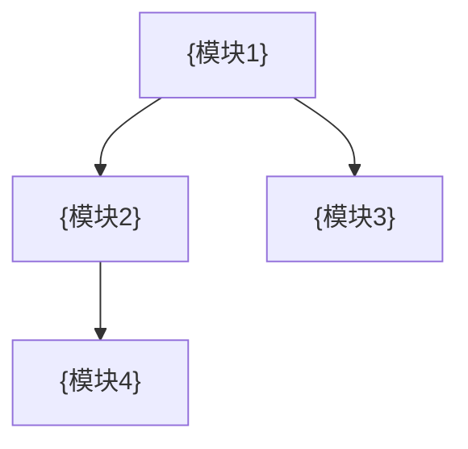

# {项目名} 概要

> **定位**: {一句话定义: 这个项目/产品是什么}
> **更新日期**: YYYY-MM-DD

---

## 一、目标用户与场景

| 用户角色 | 使用场景 | 核心痛点 |
|---------|---------|---------|
| {角色1} | {场景描述} | {痛点描述} |
| {角色2} | {场景描述} | {痛点描述} |

## 二、核心能力

| 能力 | 说明 |
|------|------|
| {能力1} | {一句话描述} |
| {能力2} | {一句话描述} |

## 三、模块全景

> 此图侧重**业务语义**关系, 技术实现架构参见 `00_Global/L1_target_architecture.md`

## 四、技术亮点

| 亮点 | 说明 |
|------|------|
| {亮点1} | {为什么选择这个方案, 区别于常规做法} |
| {亮点2} | {关键技术决策及其价值} |

## 五、术语表

| 术语 | 定义 |
|------|------|
| {术语1} | {精确定义} |
| {术语2} | {精确定义} |
